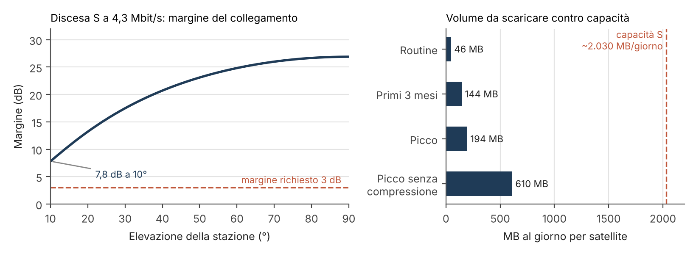

# PULSE · Report Fase A, Passo A5.5: TT&C e scarico dati

30 ottobre 2026 · Giuliano Pennacchio (missione, GNC, TT&C) · numeri del payload di Giuseppe Parisi (A5.P1–A5.P3)

## Sintesi

PULSE usa **meno del 10% di una sola banda S** anche nel caso peggiore. La banda X non serve.

- **Contatti.** Ogni satellite ha **71 min al giorno** di contatto con Svalbard, Fairbanks e Fucino (16,7 contatti, sopra 10° di elevazione). Il giorno peggiore scende a 69,5 min.
- **Il limite è la radio, non il collegamento.** A 10° di elevazione il collegamento in banda S reggerebbe ~13 Mbit/s con 3 dB di margine. La radio scarica **4,3 Mbit/s utili** con **7,8 dB di margine**, per **~2.030 MB al giorno** per satellite.
- **Volume da scaricare** (numeri di Giuseppe): 46 MB al giorno in routine, 144 MB nei primi 3 mesi, 194 MB nel picco di emergenza. Senza nessuna compressione il picco sale a 610 MB. La calibrazione del commissioning (1,7 GB) sta in meno di un giorno di capacità libera.
- **Architettura scelta:**
  - banda S per tutto, con ricetrasmettitore software unico (classe XLink-S, salita fino a 896 kbit/s);
  - radio VHF/UHF di riserva, sempre in ascolto;
  - due antenne a basso guadagno (nadir e zenit), che funzionano in qualunque assetto, anche in safe e durante la spinta;
  - TT&C completo: **0,46 kg** nominali (0,51 kg con margine) e **~34 Wh al giorno**.
- **Allarmi:**
  - quelli notturni arrivano a terra in **~6 min** (Svalbard subito dopo la ripresa);
  - quelli diurni in **~2 min** quando Fucino è ancora in vista, altrimenti in ~77 min (primo contatto con Svalbard).

| # | Decisione (30/10/2026) | Scelta | Stato |
|---|---|---|---|
| D-068 | Antenne TT&C | Due antenne quasi omnidirezionali (nadir + zenit), puntamento della stazione solo come opzione | Approvata |
| D-069 | Velocità in banda S | 4,3 Mbit/s per tutto il contatto, discesa automatica se il margine cala | Approvata |
| D-073 | Coda di scarico | 5 classi con invecchiamento (> 24 h sale di classe) | Approvata |
| D-074 | Spinta e riprese | Spinta vietata da N min prima delle sole riprese pianificate; l'emergenza la interrompe | Approvata (N TBC) |
| D-075 | Comandi | Piano per le 24 h successive caricato a ogni contatto; Fucino riserva | Approvata |
| D-080 | Antenna a nadir | Patch compatta su ceramica ≤ 60 mm; riserva su spigolo o faccia laterale | Approvata |
| D-082 | Bande | S + VHF/UHF di riserva, nessuna banda X | Approvata |
| D-083 | Archivio notturno | Scaricato nello stesso contatto notturno (sostituisce D-067) | Approvata |
| D-084 | Catena S | Ricetrasmettitore unico classe XLink-S, ricevitore S acceso solo nei contatti | Approvata |

## Obiettivo

Dimensionare il collegamento con la Terra di ogni satellite di PULSE. Le domande sono sette:
1. quanti dati bisogna scaricare e caricare;
2. quali bande servono;
3. che antenne usare e chi punta;
4. se il segnale arriva al caso peggiore;
5. se la capacità basta;
6. con quali regole si usano i contatti;
7. quanto pesa e consuma il tutto.

## Ipotesi

- **Orbita e stazioni:**
  - 4 satelliti a 302 km, inclinazione 96,8°, nodo ascendente alle 22:30, sfasati di 90°;
  - stazioni Svalbard, Fairbanks e Fucino, elevazione minima 10° (D-016);
  - contatti e accessi presi dalle simulazioni GMAT di gennaio 2026 (5 bersagli di prova).
- **Volumi:** quelli del payload decisi da Giuseppe (D-070, D-071, D-072).
- **Radio, antenne e stazione di riferimento:**
  - trasmettitore ISIS TXS2 per il link budget (31 dBm, codifica CCSDS convoluzionale + Reed-Solomon, Eb/N0 richiesto 2,4 dB, perdita di implementazione 2 dB);
  - patch S ISIS (6,5 dBic, fascio 100°);
  - stazione S da 3,7 m con G/T 12,6 dB/K (dato KSAT, wiki NTNU).
- **Ipotesi TBC:**
  - perdite di cavo (1 dB), atmosfera (0,5 dB) e polarizzazione (0,5 dB);
  - temperatura di rumore del ricevitore di bordo (600 K);
  - G/T delle stazioni UHF (yagi 14 dBic, 1.000 K);
  - 30 s di aggancio per contatto.
- **Margine minimo del collegamento:** 3 dB.

## Passaggi svolti

| Sotto-passo | Cosa si è fatto |
|---|---|
| A5.5.1 Bisogni | Raccolta dei volumi di Giuseppe; volumi di salita; telemetria di piattaforma (~5 MB al giorno, stima) |
| A5.5.2 Bande | Confronto tra solo S, S + UHF, due catene S, S + X + UHF |
| A5.5.3 Antenne | Geometria dei contatti, costo del puntamento della stazione, conflitti con riprese e spinta |
| A5.5.4 Link budget | Discesa e salita in banda S, UHF; capacità giornaliera |
| A5.5.5 Bilancia dei dati | Volume contro capacità; contatto notturno; scene d'archivio per notte |
| A5.5.6 Regole dei contatti | Coda di scarico, spinta contro passaggi, catena dei comandi, finestra di Fucino |
| A5.5.7 Budget | Scelta della catena S, righe di massa, potenza, volume e dati nel file dei budget |

## Risultati

### Contatti e geometria

| Stazione | Contatti al giorno | Minuti al giorno | Durata tipica |
|---|---|---|---|
| Svalbard | 9,7 | 43,0 | 4,7 min |
| Fairbanks | 4,6 | 18,4 | 4,4 min |
| Fucino | 2,5 | 9,8 | 4,4 min |
| **Totale** | **16,7** | **71,1** | |

I quattro satelliti non si sovrappongono mai sulla stessa stazione, quindi basta un'antenna per stazione.

**Distanza a bassa elevazione.** La perdita in più rispetto allo zenit è 20·log₁₀(distanza / 302 km). A 10° di elevazione il satellite è a 1.166 km: 20·log₁₀(1166/302) = 11,7 dB. Il segnale arriva ~15 volte più debole che sopra la stazione.

**Puntamento della stazione.** Seguire la stazione richiede al massimo 1,47°/s, 0,029 N·m·s e 4,6·10⁻⁴ N·m: gli stessi numeri della FMC notturna. Le ruote bastano già, ma il modo non serve più (niente banda X).

**Riprese e contatti:**
- Fucino è in vista durante il **100%** delle riprese sull'Italia;
- di notte Svalbard arriva 5,0–7,9 min dopo la ripresa;
- di giorno il primo contatto con Svalbard arriva 77 min dopo.

### Link budget (banda S in discesa, 10° di elevazione)

| Voce | Valore |
|---|---|
| Potenza trasmessa (31 dBm) | +1,0 dBW |
| Cavo e diplexer (TBC) | −1,0 dB |
| Patch a 70° dal nadir (modello) | −0,8 dBic |
| Perdita di spazio libero, 2,245 GHz, 1.166 km | −160,8 dB |
| Atmosfera + polarizzazione (TBC) | −1,0 dB |
| G/T della stazione | +12,6 dB/K |
| **C/N0** | **78,6 dB-Hz** |

La velocità massima si ricava da 10^((C/N0 − 2,4 − 2,0 − 3,0)/10). Esempio a 10°: 78,6 − 7,4 = 71,2 dB, cioè ~13 Mbit/s. La radio arriva a 4,3 Mbit/s utili, quindi il margine reale a 10° è **7,8 dB**: copre bene l'incertezza sul diagramma della patch.

- **Salita in banda S:** 64–256 kbit/s passano con 17–23 dB di margine. Il limite è il ricevitore di bordo (D-084).
- **UHF in discesa:** 9.600 bit/s con 4,8 dB di margine (G/T della stazione stimata), ~4 MB al giorno.



### Bilancia dei dati (per satellite)

| Caso | Volume al giorno | Quota della capacità (~2.030 MB al giorno) |
|---|---|---|
| Routine | ~46 MB | 2,3% |
| Primi 3 mesi | ~144 MB | 7,1% |
| Picco di emergenza | ~194 MB | 9,6% |
| Picco senza compressione | ~610 MB | 30% |

**Salita.** Servono 300–750 MB l'anno; il pacchetto più grande sono i pesi della rete (~50 MB): ~52 min a 128 kbit/s, cioè meno di un giorno di contatti.

**Contatto notturno.** Il contatto con Svalbard dopo la ripresa dura 213–263 s, cioè **98–125 MB**. I prodotti notturni nel caso peggiore sono ~37 MB: zone candidate 25 MB + 4 scene d'archivio da 3,1 MB + telemetria.

**Scene diurne (stima di primo ordine).** Ogni satellite passa di giorno sull'Italia 0,9 volte al giorno, con 2,7 scene di media e 4 nel 40% dei giorni. Il valore "fino a 4" di D-072 è il tetto usato nel budget.

**Archivio notturno.** ~2–4 scene per satellite per notte, ~11 con 4 satelliti. Tutta l'Italia (~3.100 scene) richiede ~290 notti utili; città e zone a rischio si coprono molto prima.

### Regole dei contatti

- **Spinta.** Vietandola da 60 min prima delle riprese a 5 min dopo, restano **22,4 h al giorno** (21,7 h con 90 min), contro le 4,2–7,8 h necessarie. Il vincolo vero sarà la potenza in eclissi (A5.6).
- **Fucino dopo l'ultima ripresa.** Di giorno resta in vista 50–198 s (mediana 106–136 s), cioè ~20–36 MB in mediana dopo 60 s di AI. Di notte resta solo 27–131 s (mediana 45–65 s), cioè niente: il passaggio va da sud a nord e l'ultimo bersaglio è lontano da Fucino. Per questo D-081 è approvata solo per gli allarmi diurni (G2).

### Budget TT&C

| Voce | Massa nominale | Potenza |
|---|---|---|
| Ricetrasmettitore S (classe XLink-S) | 0,200 kg | < 15 W con TX e RX, < 4 W solo RX |
| Radio VHF/UHF di riserva (classe ISIS) | 0,075 kg | 0,48 W sempre in ricezione, 4 W in trasmissione |
| 2 patch S + antenna VHF/UHF dispiegabile | 0,189 kg | passive (2 W per < 3 s al dispiegamento) |
| **Totale** | **0,464 kg** (0,51 kg con margine 10%) | **~34 Wh al giorno** |

L'energia giornaliera si divide così:
- trasmissione: 15 W × 71 min = 17,8 Wh;
- ricezione S solo nei contatti: 4 W × 1,3 h = 5,2 Wh;
- ricevitore VHF sempre acceso: 11,5 Wh.

Con il ricevitore S acceso sempre servirebbero 96 Wh al giorno solo di ricezione.

## Decisioni prese

| ID | Data | Decisione | Opzioni scartate |
|---|---|---|---|
| D-065 | 26/10 | Approvata la catena di conferma dei blackout di Giuseppe, con la latenza corretta: ~10 min invece di ~9–10 h | — |
| D-066 | 26/10 | Seconda ripresa notturna pianificata in anticipo (16–28% dei casi) | Nessuna seconda ripresa; su richiesta (Fase B) |
| D-068 | 30/10 | Due antenne a basso guadagno nadir + zenit; puntamento della stazione opzionale | Patch fissa ±60°; antenna puntata |
| D-069 | 30/10 | Banda S a 4,3 Mbit/s con ripiego automatico | 1 Mbit/s fisso; 4,3 Mbit/s senza ripiego |
| D-073 | 30/10 | Coda a 5 classi con invecchiamento | Classi fisse; ordine deciso da terra |
| D-074 | 30/10 | Spinta vietata solo prima delle riprese pianificate; l'emergenza la interrompe | Divieto prima di ogni passaggio |
| D-075 | 30/10 | Piano per 24 h caricato a ogni contatto; Fucino riserva; comandi autenticati | Comandi nello stesso passaggio |
| D-080 | 30/10 | Patch a nadir compatta ≤ 60 mm | Spostare il telescopio; antenna laterale (riserva) |
| D-082 | 30/10 | S + VHF/UHF di riserva | Solo S; due catene S; S + X + UHF |
| D-083 | 30/10 | Archivio nello stesso contatto notturno (sostituisce D-067) | In coda entro 24 h |
| D-084 | 30/10 | Ricetrasmettitore S unico classe XLink-S | ISIS TXS2 + ricevitore (salita 9,6 kbit/s); due box |

Proposte di Giuseppe approvate in questo passo:
- D-070 (ritaglio dell'allarme diurno);
- D-072 (fino a 4 scene diurne al giorno);
- D-076 (telescopio in asse);
- D-078 (telescopio contro un lato della faccia a nadir);
- D-079 (paraluce, Sole a ≥ 52°);
- D-081 (scheda di bordo; Fucino solo per gli allarmi diurni, G2).

## Requisiti derivati

| ID | Requisito | Valore | Stato |
|---|---|---|---|
| DR-28 | Inseguimento della stazione solo se si adotta la banda X | 1,47°/s, 0,029 N·m·s | TBC |
| DR-36 | Scene notturne di riferimento | ~2–4 per satellite per notte, scaricate nello stesso contatto | TBC |
| DR-40 | Comandi e telemetria in qualunque assetto | ≥ 95% del contatto sopra 10° | TBC |
| DR-41 | Discesa S alla velocità nominale fino a 10° | 4,3 Mbit/s, margine ≥ 3 dB (calcolato 7,8) | TBC |
| DR-45 | Coda di scarico per classi con invecchiamento | 5 classi, > 24 h sale di classe | TBC |
| DR-46 | L'emergenza interrompe la spinta in tempo per la ripresa | N min dal termico | TBD |
| DR-47 | Comandi autenticati e cifrati, piano a tempo | CCSDS SDLS, ≥ 24 h | TBC |
| DR-48 | Allarmi diurni pronti per Fucino nello stesso passaggio (obiettivo) | ≤ ~60 s dall'ultima ripresa | TBC |
| DR-49 | Seconda via di comando indipendente | VHF in salita, UHF in discesa 9.600 bit/s, margine ≥ 3 dB | TBC |
| DR-50 | Ricezione dei comandi in ogni momento | S nelle finestre di contatto, VHF sempre | TBC |

## Rischi nuovi

| ID | Rischio | Probabilità × impatto | Mitigazione |
|---|---|---|---|
| R-39 | Spazio sulla faccia a nadir per l'antenna | Media × Bassa | Patch compatta (D-080); riserva laterale. In mitigazione |
| R-40 | Licenza S più stretta di ~6,8 MHz o in ritardo | Media × Media | Pratica in Fase B; anche a 1 Mbit/s il picco passa |
| R-45 | Mancato dispiegamento dell'antenna VHF/UHF | Bassa × Media | Eredità di volo e prove; la banda S resta |
| R-46 | Eredità di volo della radio classe XLink-S non verificabile | Media × Media | Verifica con il costruttore; ripiego ISIS (salita lenta) |

R-44 (finestra di Fucino troppo corta) è di Giuseppe: con la scelta G2 vale solo di giorno.

## Prossimi passi

- **A5.6 Potenza:**
  - TT&C ~34 Wh al giorno;
  - picco radio S (15 W) insieme alla scheda AI subito dopo le riprese;
  - spinta da 50 W in eclissi;
  - pannelli perpendicolari all'asse del telescopio (safe con coperchio bloccato aperto, R-43).
- **A5.7 Layout:** patch a nadir nella striscia di 66 × 206 mm, patch a zenit e antenna VHF/UHF su facce libere, baricentro (D-047).
- **Fase B:**
  - G/T reali delle antenne di Svalbard, Fairbanks e Fucino, e ricezione S a Fucino (Telespazio);
  - licenze S e VHF/UHF;
  - prodotto della patch compatta e suo diagramma;
  - eredità di volo della radio S;
  - link budget rifatto con i valori reali.
- **A6:** frazione di notti utili per l'archivio; priorità tra i bersagli.

## Codice

Gli script leggono le uscite GMAT in `../../PULSE_GMAT/Output_PULSE/` e scrivono in `risultati/`.

```bash
pip install -r requirements.txt
python ora_notte.py         > risultati/ora_notte.txt
python contatti_notte.py    > risultati/contatti_notte.txt
python tempo_contatto.py    > risultati/tempo_contatto.txt
python antenne_geometria.py > risultati/antenne_geometria.txt
python conflitti.py         > risultati/conflitti.txt
python link_budget.py       > risultati/link_budget.txt
python spinta_passaggi.py   > risultati/spinta_passaggi.txt
python scene_diurne.py      > risultati/scene_diurne.txt
python fucino_residuo.py    > risultati/fucino_residuo.txt
python figura_link.py                                    # risultati/figura_link.png
```

| Script | Sotto-passo / decisione | Cosa calcola |
|---|---|---|
| `ora_notte.py` | A4 (D-060) | Ora solare del passaggio notturno sull'Italia |
| `contatti_notte.py` | A4 (D-065, D-066) | Scarico dopo la ripresa notturna; seconda ripresa con il satellite successivo |
| `tempo_contatto.py` | A5.5.1 | Contatti e minuti al giorno per stazione; capacità per banda |
| `antenne_geometria.py` | A5.5.3 (D-068) | Distanza e perdita in funzione dell'elevazione; costo ADCS del puntamento della stazione |
| `conflitti.py` | A5.5.3, A5.5.6 | Contatti contro riprese sull'Italia |
| `link_budget.py` | A5.5.4 (D-069), A5.5.7 (D-084) | Link budget S e UHF; capacità giornaliera; energia delle radio |
| `spinta_passaggi.py` | A5.5.6 (D-074) | Tempo libero per la spinta attorno ai passaggi sull'Italia |
| `scene_diurne.py` | D-072, D-083 | Passaggi diurni sull'Italia e scene possibili (stima di primo ordine) |
| `fucino_residuo.py` | D-081 (G2), DR-48 | Tempo di contatto con Fucino dopo l'ultima ripresa |
| `figura_link.py` | Report | Figura del margine e della bilancia dei dati |

## Limiti

- Contatti e accessi da un solo mese (gennaio 2026) e da 5 bersagli di prova.
- Elevazione nei contatti ricavata dalla durata del contatto (Terra non rotante).
- Diagramma della patch modellato con cos^n dal fascio di 100° (nessun dato oltre i 50°).
- G/T delle stazioni da un solo esempio (KSAT 3,7 m); G/T UHF stimata.
- `scene_diurne.py` usa un'orbita circolare semplice e l'Italia come poligono grossolano.
- Volumi del payload: stime di primo ordine di Giuseppe (TBC fino alla scelta della scheda).

## Fonti

- [ISIS TXS2 S-band transmitter, datasheet](https://www.isispace.nl/wp-content/uploads/2023/02/ISIS-TXS2-DSH-0001-TXS2_Datasheet-02_02.pdf)
- [ISIS S-band patch antenna, datasheet](https://www.isispace.nl/wp-content/uploads/2021/01/ISIS-SSPA-DSH-0001-S_Patch_Antenna_Datasheet-02_00.pdf)
- [ISIS S-band transceiver](https://isispace.nl/?p=142431)
- [ISIS VHF uplink / UHF downlink transceiver](https://www.isispace.nl/?p=2381)
- [ISIS Antenna System, datasheet](https://www.isispace.nl/wp-content/uploads/2021/01/ISIS-ANTS-DSH-0001-Antenna_System_Datasheet-04_00.pdf)
- [IQ spacecom XLink-S (satsearch)](https://satsearch.co/products/iq-xlink-s)
- [EnduroSat S-band transceiver](https://endurosat.com/products/s-band-transceiver)
- [AAC Clyde Space PULSAR-SANT](https://www.aac-clyde.space/wp-content/uploads/2021/10/PULSAR-SANT-1.pdf)
- [CUBECOM SANT S-band patch (satsearch)](https://satsearch.co/products/cubecom-sant-s-band-patch-antenna)
- [NTNU – Ground stations specifications (KSAT S-band 3,7 m)](https://ntnu.no/wiki/x/cgjvBg)
